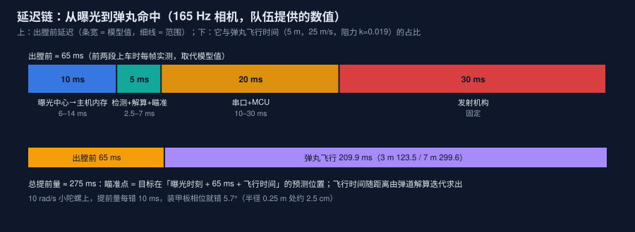
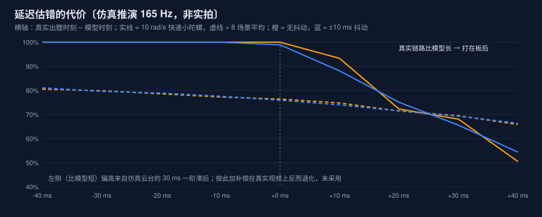
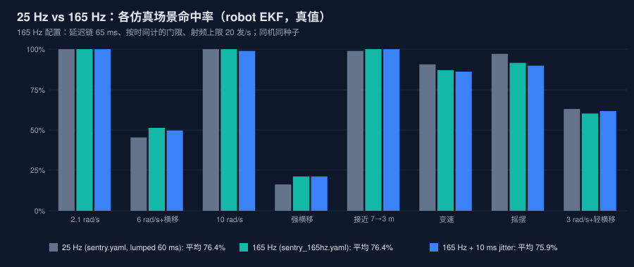
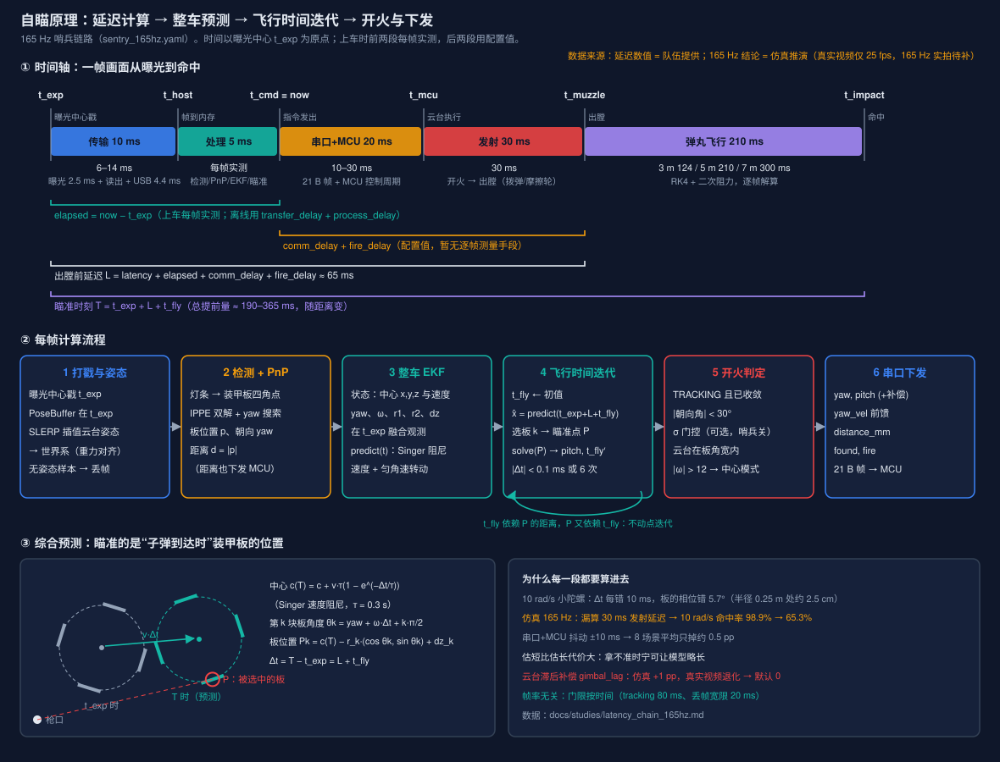
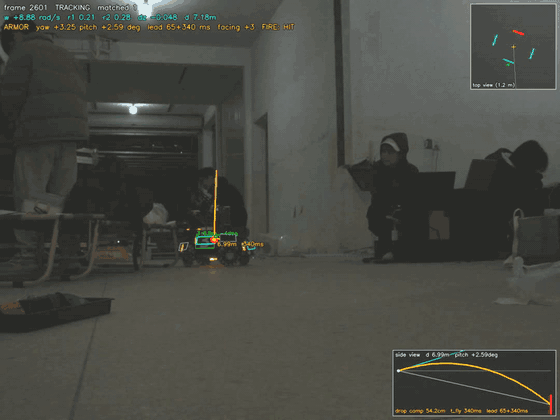
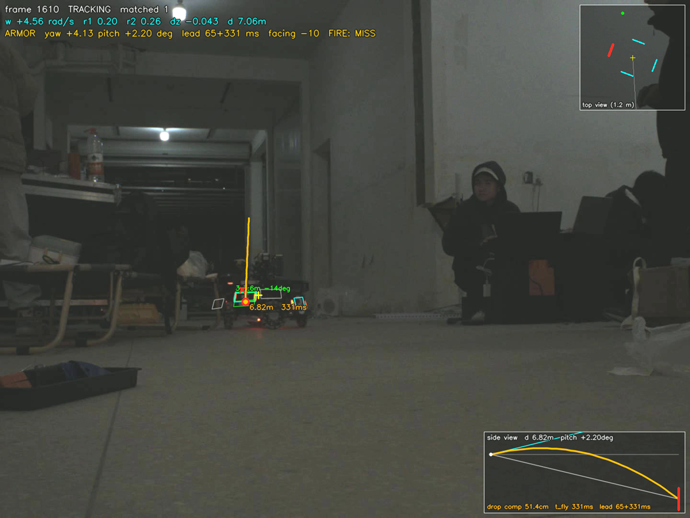

# 延迟链拆分 + 165 Hz 适配（2026-11-17）

> **数据来源标注（重要）**：仓库现有的两段真实视频（3.avi / 4.avi）都是 **25 fps**。
> 本文所有 **165 Hz** 的数字都来自**仿真器推演**（`autoaim_sim`，真值判定），
> **不是 165 Hz 实拍**。165 Hz 实拍录像由队伍后期提供，届时用它复核本文结论并建 165 Hz 基线。
> 下文每一节和每张表都标注了来源：
>
> | 标记 | 含义 |
> |---|---|
> | 〔真实视频 25 fps〕 | Release 附件 3.avi / 4.avi，1440×1080、25 fps，虚拟射击评测 |
> | 〔仿真 165 Hz〕 / 〔仿真 25 Hz〕 | `autoaim_sim` 合成场景，真值判定；绝对值随机器漂移几个点 |
> | 〔队伍提供〕 | 队伍在对话中给出的延迟数值，测量方法与原始数据待补 |
> | 〔本机实测〕 | 在本次开发机上实测（如检测耗时） |
>
> | 结论 | 来源 | 165 Hz 实拍后要复核吗 |
> |---|---|---|
> | 延迟链各段数值（65 ms） | 〔队伍提供〕 | 是：上车逐项实测 |
> | 延迟估错的代价（漏算 30 ms → 65.3%） | 〔仿真 165 Hz〕 | 是 |
> | 165 Hz 对比 25 Hz 的场景命中率 | 〔仿真 165 Hz〕〔仿真 25 Hz〕 | 是 |
> | `gimbal_lag` 被否决 | 〔真实视频 25 fps〕（仿真结果相反） | 是：165 Hz 下云台滞后占比不同 |
> | 新参数默认值不改变冻结基线（12 项偏差 0.0） | 〔真实视频 25 fps〕 | 否：这是代码等价性验证 |
> | 165 Hz 配置的时间门限（80 ms / 20 ms / 0.2 s） | 按 25 Hz 的时间含义换算，未经实拍调参 | 是 |

**结论先行**
- 原来所有延迟都打包成一个常数 `aimer.latency = 60 ms`。现在拆成四段：
  传输、处理、串口+MCU、发射。上车时，“曝光→瞄准”这一段改为**每帧实测**，
  不再用估计值。
- 〔队伍提供〕按队伍提供的数值，出膛前延迟约 **65 ms**，5 m 处弹丸飞行约 **210 ms**，
  所以总提前量约 **275 ms**。
- 〔仿真 165 Hz〕仿真推演（真值判定）：延迟每低估 10 ms，10 rad/s 小陀螺的命中率就从
  98.9% 掉到 88.1%。**如果漏算 30 ms 的发射延迟，会掉到 65.3%**。
  串口+MCU 本身 ±10 ms 的抖动代价很小（平均 −0.5 pp）。
- 帧数类门限（`tracking_thres`、`lost_grace_frames`、`warmup_frames`、ROI 全扫周期）
  都新增了按时间计的版本。在 165 Hz 下，“3 帧”只有 18 ms 的证据。
- 评测器原来每帧开一枪，165 Hz 下会给出 110 发/秒这种不可能的射速。
  现在加了 `eval.max_shot_rate` 上限。
- “云台滞后补偿”（`gimbal_lag`）〔仿真〕平均 +1 pp，但〔真实视频 25 fps〕**否决**：
  4.avi 上 68.6% → 56.3%（补偿 40 ms 时）。所以出厂保持 0，不启用。
- 所有新参数默认 0，等于历史行为。〔真实视频 25 fps〕冻结基线 12 项偏差全部 0.0，
  仿真表与改动前逐字节一致。

## 1. 延迟链〔队伍提供〕



| 段 | 队伍给的范围 | 模型值（`sentry_165hz.yaml`） | 上车时 |
|---|---|---:|---|
| 曝光中心 → 主机内存（曝光 2.5 ms、USB 4.4 ms 等） | 6–14 ms | `transfer_delay` 10 ms | 与下一段合并，每帧实测 `now − stamp` |
| 检测 + 解算 + 瞄准 | 〔本机实测〕检测 2.5 ms/帧 | `process_delay` 5 ms | 同上 |
| 串口 + MCU | 10–30 ms | `comm_delay` 20 ms | 模型值（MCU 无时间戳，无法逐帧测） |
| 发射机构（开火 → 出膛） | 30 ms | `fire_delay` 30 ms | 模型值 |
| 弹丸飞行（25 m/s，k = 0.019） | 3 m 124 / 5 m 210 / 7 m 300 ms | — | 弹道解算逐帧迭代 |

瞄准点就是目标在“曝光时刻 + 出膛前延迟 + 飞行时间”时的预测位置。飞行时间
又取决于这个位置的距离，所以由 `RobotAimer` 做不动点迭代求解，这部分不变。

**每帧实测。** `sentry_robot` 在接实体相机时会调用 `SentryVision::setHostClock(nowSeconds)`：
每一帧都用 `now − 曝光戳` 替代 `transfer_delay + process_delay`。处理耗时逐帧在变
（README 记录：全帧约 6.3 ms，ROI 帧 1.3–1.6 ms），不必再用一个平均值去猜。回放视频时用的是媒体时间，
`now − stamp` 没有意义，所以不启用实测。调试窗口会显示每一段的值。

**数值身份。** 以上数值是队伍在对话中给出的范围，测量方法和原始数据还没附上。
因此它们只写进 `sentry_165hz.yaml`，并标注为“队伍提供的数值”，没有回写进
`core/config/default.yaml`，也没有当作实测标定。串口+MCU 的 10–30 ms 跨度最大，
值得优先测准（例如用 MCU 回显一个序号，测往返时间）。

## 2. 延迟估错的代价〔仿真 165 Hz〕

`autoaim_sim` 新增了 `--latency-error S` 和 `--latency-jitter S` 两个参数：
弹丸真实的出膛时刻 = 模型时刻 + 误差 + U(−抖动, +抖动)，而瞄准器并不知道这个偏差。



| 真实 − 模型 | 平均（无抖动） | 10 rad/s（无抖动） | 平均（±10 ms） | 10 rad/s（±10 ms） |
|---:|---:|---:|---:|---:|
| −40 ms | 80.5% | 100.0% | 81.1% | 100.0% |
| −20 ms | 78.6% | 100.0% | 78.9% | 100.0% |
| 0 | 76.4% | 100.0% | 75.9% | 98.9% |
| +10 ms | 74.8% | 93.3% | 74.0% | 88.1% |
| +20 ms | 71.4% | 72.3% | 71.5% | 75.1% |
| +30 ms | 69.5% | 68.1% | 69.3% | 65.6% |
| +40 ms | 65.9% | 50.5% | 66.4% | 54.4% |

（完整数据见 `tools/latency_study.json`）

| 情形（165 Hz） | 误差 | 抖动 | 平均命中 | 10 rad/s |
|---|---:|---:|---:|---:|
| 链路拆分 + 每帧实测（本次方案） | 0 | ±10 ms | 75.9% | 98.9% |
| 沿用旧的 60 ms 打包值 | +5 ms | ±12 ms | 75.1% | 93.3% |
| 漏算发射延迟 30 ms | +30 ms | ±12 ms | 69.1% | 65.3% |
| 串口按下限 10 ms 估（真实 20 ms） | +10 ms | ±10 ms | 74.0% | 88.1% |
| 串口按上限 30 ms 估（真实 20 ms） | −10 ms | ±10 ms | 77.6% | 100.0% |

**为什么曲线左高右低。** 仿真云台是一阶滞后（τ = 30 ms），枪口实际指向的是 30 ms 前的指令；
所以“真实出膛比模型早”反而抵消了这段滞后。我据此加了 `aimer.gimbal_lag`（预测再往前推）
并做了扫描：

| gimbal_lag | 〔仿真 165 Hz〕平均（±10 ms 抖动） | 〔真实 25 fps〕3.avi 参考口径 | 〔真实 25 fps〕4.avi 参考口径 | 〔真实 25 fps〕3.avi 出厂口径 | 〔真实 25 fps〕4.avi 出厂口径 |
|---:|---:|---:|---:|---:|---:|
| 0 | 75.9% | **67.5%** | **68.6%** | **58.1%** | **66.9%** |
| 10 ms | 76.6% | 66.2% | 69.0% | 57.9% | 68.4% |
| 20 ms | 76.3% | 65.9% | 66.6% | 57.2% | 67.7% |
| 30 ms | 77.1% | 66.1% | 63.4% | 57.7% | 63.8% |
| 40 ms | 77.6% | 65.0% | 56.3% | 57.0% | 59.8% |

真实视频在 ≥ 20 ms 时明显退化，所以**不出厂**。这和 README 里“仿真调出的参数被真实视频否决”
是同一个教训。参数保留、默认 0，等上车实测出云台的真实响应滞后后再定。
如果误差的方向不确定，宁可让模型略**长**：从表中看，低估延迟（右侧）的代价远大于高估。

## 3. 165 Hz〔仿真 165 Hz / 仿真 25 Hz，非实拍〕



| 场景（全部为仿真） | 仿真 25 Hz（sentry.yaml，60 ms） | 仿真 165 Hz（sentry_165hz.yaml） | 仿真 165 Hz + ±10 ms 抖动 |
|---|---:|---:|---:|
| 旋转 2.1 rad/s、5 m | 100.0 | 100.0 | 100.0 |
| 旋转 6 rad/s + 横移 0.5 m | 45.4 | 51.3 | 49.7 |
| 快速旋转 10 rad/s、4 m | 100.0 | 100.0 | 98.9 |
| 不旋转，强横移 0.8 m | 16.3 | 21.2 | 21.2 |
| 旋转 4 rad/s，接近 7→3 m | 98.9 | 100.0 | 100.0 |
| 变速旋转 0.5–4.5 rad/s | 90.6 | 87.0 | 86.1 |
| 摇摆 ±3 rad/s | 97.1 | 91.5 | 89.8 |
| 旋转 3 rad/s + 轻横移 | 63.0 | 60.2 | 61.7 |

165 Hz 在横移场景上多出 5 pp 左右；变速和摇摆略降。可能的原因是 165 Hz 配置的提前量是 65 ms，
比 25 Hz 配置的 60 ms 长，这一点没有单独拆开验证。剩下的脱靶仍然集中在强横移，这是恒速类模型的结构性问题（见 README 局限）。
**跟踪器的噪声参数没有为 165 Hz 重调**：没有 165 Hz 的真实录像，只靠仿真去调，正是上面那个陷阱。

帧率相关的改动：

| 原来按帧计 | 新增按时间计 | 165 Hz 配置 |
|---|---|---|
| `tracker.tracking_thres` = 3 帧（25 Hz 下 80 ms，165 Hz 下 12 ms） | `tracking_thres_time` | 0.08 s |
| `tracker.lost_grace_frames` | `lost_grace_time` | 0.02 s（约 3 帧） |
| `aimer.warmup_frames` | `warmup_time` | 0 |
| ROI 全扫每 30 帧（1.2 s / 0.18 s） | `target.roi_full_scan_period` | 0.2 s |
| 评测器每帧一枪 | `eval.max_shot_rate` | 20 发/s |

**计算预算提醒。** 165 Hz 时每帧只有 6.06 ms。本机全帧检测 2.5 ms（README 记录的另一台机器是 6.3 ms），
在车载算力上可能超预算。超预算时帧会排队，而排队时间会被每帧实测计入提前量，所以不会悄悄打偏，
但提前量会变长。如果车载机超预算，应开启 `--roi`（检测 1.3–1.6 ms），并让相机源只取最新帧。

## 4. 原理图



由 `tools/make_diagrams.py` 生成。图中从左到右依次是：曝光打戳、延迟链（每段的计算方法）、
整车 EKF 外推、飞行时间的不动点迭代、选板与开火判定，以及串口下发的内容。

## 5. 抛物线轨迹预测（`feat/parabola-prediction` 分支）

`Ballistics::trajectory()` 用和瞄准相同的 RK4 + 二次阻力模型，沿射程采样弹道点。
`drawTrajectory()` 把弹道投影到画面上，`drawTrajectorySideView()` 用侧视小窗画出抛物线。
这些只用于显示，不进入瞄准计算。

真实视频（4.avi，约 8 rad/s 小陀螺，25 fps 录像，用 165 Hz 配置的延迟链渲染，画面已提亮）：
橙线是投影到画面上的预测弹道，弹着点旁标注距离和飞行时间；
右下角侧视小窗画出抛物线弹道、视线（灰）、枪管方向（青）和目标板（红），
并标注下坠补偿量和“出膛前延迟 + 飞行时间”。





从相机看，弹道几乎沿视线方向，所以在画面里只是一条从上往下落到目标的线。
抛物线只有在侧视里才看得出来：6.8 m 处下坠补偿约 51 cm、飞行 331 ms。

复现：

```bash
./build/apps/autoaim_video video/4.avi --config core/config/default.yaml \
  --set latency=0 --set transfer_delay=0.010 --set process_delay=0.005 \
  --set comm_delay=0.020 --set fire_delay=0.030 --render 2600:2725
```

## 复现

```bash
cmake --build build -j
python3 tools/latency_study.py          # 跑仿真 → tools/latency_study.json + 3 张图
./build/apps/autoaim_video video/4.avi --sweep gimbal_lag=0,0.01,0.02,0.03,0.04
```

仿真绝对值在不同机器之间会漂移几个点（BASELINE.md）。本机未改代码时的仿真平均是 73.6，
`tools/regression.py` 的仿真门禁需要加 `--sim-ref 73.6` 才能通过，这与本次改动无关。

## 上车待验
- **165 Hz 实拍录像（队伍后期提供）**：复核本文所有〔仿真 165 Hz〕结论，建 165 Hz 视频基线。
- 串口+MCU 的真实分布（10–30 ms 跨度太大）；发射延迟 30 ms 的测量方法。
- 云台的真实响应滞后，之后再决定 `gimbal_lag`。
- 165 Hz 真实录像，用来给跟踪噪声参数建 N1 基线。
- 车载机的全帧检测耗时，以及是否必须开 ROI。
